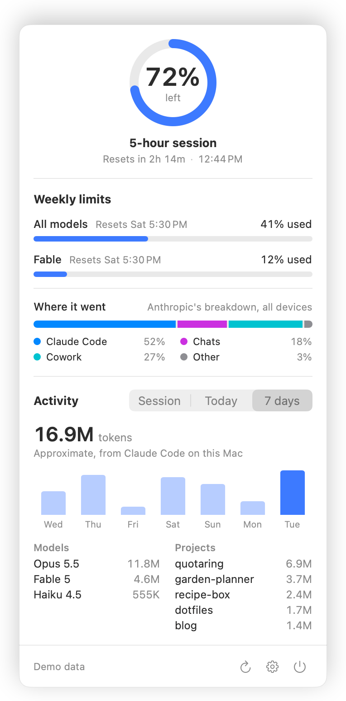

# QuotaRing

A tiny, auditable menu bar meter for your Claude subscription limits.

QuotaRing puts a ring in your macOS menu bar that shows how much of your rolling 5-hour Claude limit is left. Click it
for weekly limits, the reset time and a breakdown of where your tokens went.



It exists because menu bar usage meters are easy to build and hard to trust. The goal here is the opposite: a small,
open-source app whose behavior you can read in an afternoon. Everything it reads, sends and stores is listed in
[How it works and privacy](#how-it-works-and-privacy) below.

## Features

- **Menu bar ring.** Shows the share of the 5-hour session limit that remains, with optional percentage text. The ring
  turns orange at 20% remaining or less and red at 5% or less.
- **Popover.** One click shows:
  - the session limit with a reset countdown and clock time;
  - weekly limits (all models, plus any model-specific limits) and extra usage when it is enabled;
  - Anthropic's own "where it went" breakdown for the week, when available;
  - local activity: tokens by model, top projects and a 7-day chart, for the current session, today or the last 7 days.
- **Honest about old data.** When the numbers are older than two refresh intervals, the menu bar dims the percentage and
  draws a dashed arc on a dashed faint track instead of the solid ring, and shows "–" with a dashed track alone instead
  of a number when that old session window has already reset. The popover footer says where the numbers came from and how old they are. See
  [Keeping the numbers fresh](#keeping-the-numbers-fresh).
- **Notifications.** Local notifications when session usage crosses a threshold (default 80% and 95% used), once per
  window. An optional notice when the session resets (off by default).
- **Auto-refresh with Claude Code (opt-in).** If you use the Claude desktop app, QuotaRing can run Claude Code's own
  `/usage` in the background so the numbers stay fresh. It makes no AI request, spends no usage, and QuotaRing never
  touches your login. See [Auto-refresh](#auto-refresh-opt-in-runs-claude-codes-own-usage).
- **Settings.** Launch at login, refresh interval (3, 5, 10 or 15 minutes), ring shows remaining or used, percentage
  text on or off, notification thresholds, Claude config directory, the auto-refresh switch and the Live mode switch.
- **Token-free by default.** The default mode needs no credentials and makes no network connections.
- **Native and small.** Swift 6, AppKit and SwiftUI, universal binary, no third-party runtime dependencies.
- **Light and dark mode, VoiceOver labels, Reduce Motion.** English and Turkish.

Percentages are **percent used**, exactly as Anthropic reports them (the same numbers as `/usage` in Claude Code). The
ring shows what remains (100 minus used) by default; you can switch it to show what is used.

## Requirements

- macOS 14 Sonoma or later (Apple silicon or Intel)
- A Claude subscription and Claude Code. In the default mode QuotaRing reads the usage cache that **only Claude Code's
  `claude` program updates** (a session or `/usage`); the Claude desktop app's own windows do not (verified on
  2026-10-21). If you mostly use the desktop app, turn on auto-refresh, which can use the copy of Claude Code the
  desktop app keeps for itself, or read [Keeping the numbers fresh](#keeping-the-numbers-fresh).

## Install

### From GitHub Releases (recommended)

1. Download `QuotaRing-<version>.dmg` (or `QuotaRing-<version>.zip`) from the
   [Releases](https://github.com/BartugKaan/QuotaRing/releases) page.
2. Open the DMG and drag QuotaRing to Applications, then launch it. It has no Dock icon; look for the ring in the menu
   bar.

Release builds are signed with a Developer ID certificate, **notarized by Apple** and stapled, so Gatekeeper opens them
normally. macOS may show a one-time "downloaded from the Internet" confirmation on first launch. If macOS ever says it
cannot verify the app, do not work around the warning: delete the download and check it using
[Verify your download](#verify-your-download).

#### Verify your download

Optional, recommended if you want to be sure what you run. Each release publishes
`QuotaRing-<version>.dmg`, `QuotaRing-<version>.zip` and a `SHA256SUMS` file. Put the file you downloaded and
`SHA256SUMS` in the same folder, then:

```sh
VERSION=0.1.0   # the version you downloaded

# Compare the file with the published checksums (use .zip instead of .dmg for the zip)
grep "QuotaRing-$VERSION\.dmg\$" SHA256SUMS | shasum -a 256 -c

# Verify GitHub's build provenance attestation (needs the GitHub CLI)
gh attestation verify "QuotaRing-$VERSION.dmg" --repo BartugKaan/QuotaRing

# Check the installed app's signature and notarization
codesign --verify --deep --strict --verbose=2 /Applications/QuotaRing.app
spctl --assess --type execute --verbose=2 /Applications/QuotaRing.app
```

The attestation ties the file to the exact commit and workflow run in this repository that built it.

### Build from source

You need macOS 14+, Xcode 16.4 or later (Swift 6; CI builds with Xcode 16.4 and with the newest Xcode) and
[Homebrew](https://brew.sh).

```sh
git clone https://github.com/BartugKaan/QuotaRing.git
cd QuotaRing
make setup   # installs XcodeGen through Homebrew (see Brewfile)
make run     # generates the Xcode project, builds and launches the app
```

Other targets: `make demo` (launch with fixture data), `make test` (Core), `make test-app` (the app's unit tests),
`make test-all` (both), `make lint`, `make format`. See
[CONTRIBUTING.md](CONTRIBUTING.md) for the full list.

Builds from source are **ad-hoc signed** ("Sign to Run Locally") so anyone can build them without a developer account.
If you build often and use Live mode, macOS may ask again for Keychain access after a rebuild, because the signature
changes. To keep a stable signature, copy [`Configs/Local.xcconfig.example`](Configs/Local.xcconfig.example) to
`Configs/Local.xcconfig` (git-ignored) and put your own team there.

`make demo` runs the app on built-in fixture data. It does not touch the Keychain, the network or your Claude files,
which makes it safe for screenshots and for trying the UI.

## How it works and privacy

QuotaRing reads three things. Two of them are always on and are purely local. The third is opt-in. Separately, and
also only if you allow it, QuotaRing can run one fixed Claude Code command so that Claude Code refreshes its own cache.

| Source | What is read | Needs a token | Leaves your Mac |
| --- | --- | --- | --- |
| **Claude Code's cached usage snapshot** | One entry, `cachedUsageUtilization`, from `~/.claude.json` (plus an account id used only to check it, see below) | No | No |
| **Local transcripts** | Token counts from `~/.claude/projects/**/*.jsonl` | No | No |
| **Live endpoint** (opt-in "Live mode") | Claude Code's OAuth token from the Keychain, used for one request | Yes | The token goes to `api.anthropic.com` only |
| **Auto-refresh** (opt-in) | Nothing extra: QuotaRing runs `claude -p "/usage" …`, Claude Code rewrites its own cache, and QuotaRing reads that cache as above | Not QuotaRing: Claude Code uses its own login | Claude Code asks Anthropic for your usage, as `/usage` always does; QuotaRing sends nothing |

If you set a custom Claude config directory in Settings, the same files are read from there instead.

### Keeping the numbers fresh

The default mode shows what Claude Code last wrote to its cache, and **only the `claude` command-line tool writes it**:
starting a session or running `/usage` updates it. The Claude desktop app does not update that cache (verified on
2026-10-21). If the desktop app is how you use Claude, the default mode has nothing new to show.

QuotaRing does not hide that. When the numbers are older than two refresh intervals (10 minutes with the default
interval), it marks them as out of date: the menu bar dims the percentage and draws a dashed arc on a dashed faint
track, and the popover says so. If that old session window has already reset, the menu bar shows "–" and a dashed track
alone rather than a number, because the old percentage no longer applies.

If you use the desktop app, you have three options:

1. **Turn on auto-refresh (recommended).** The first-run window offers it, and Settings → Data has the switch.
   QuotaRing then runs Claude Code's own `/usage` in the background whenever the numbers are older than your refresh
   interval. Claude Code uses and renews its own login, so this keeps working for as long as Claude Code itself is
   signed in. See [Auto-refresh](#auto-refresh-opt-in-runs-claude-codes-own-usage).
2. **Run `claude` or `/usage` yourself now and then.** QuotaRing picks up the new snapshot within about 30 seconds.
3. **Turn on Live mode.** QuotaRing then asks Anthropic for your usage itself. It stays fresh for roughly as long as
   Claude Code's login token is valid, which is about 8 hours after the CLI last ran. After that Live mode pauses until
   Claude Code renews the token, because QuotaRing never refreshes it (see [Live mode](#live-mode-opt-in-one-host)).
   With auto-refresh on, Claude Code renews that token itself, so the two work well together.

### Default mode: nothing leaves your Mac

- **The cache.** Claude Code stores the last usage response it fetched in `~/.claude.json`. That file also holds
  unrelated and potentially sensitive configuration (MCP server definitions, account details). QuotaRing reads the file
  into memory only to find the `cachedUsageUtilization` key, keeps that one value, and drops the rest immediately. The
  rest is never logged, stored or sent anywhere. The one exception is a comparison: the cache entry and the file's
  `oauthAccount` each carry an account id, and QuotaRing checks that they match so that numbers from another account are
  never shown. The ids are compared and dropped, never stored or logged. If they differ, QuotaRing discards everything
  it holds for that account: the cached, the saved and the live numbers. It checks the file's size and modification time
  every 30 seconds and parses it only when it changed. Files over 50 MB are skipped, and a cached snapshot dated more
  than 5 minutes in the future is rejected (it would otherwise look fresh until then). If the file exists but cannot be
  read (too large, unreadable, or still malformed after 90 seconds), the popover shows a warning. QuotaRing **never
  writes** this file.
- **The transcripts.** Claude Code writes conversation logs to `~/.claude/projects`. QuotaRing parses them to count
  tokens, and keeps only the timestamp, model name, token counts, the project folder name and the message id used to
  avoid double counting. Prompt and response text is not retained. The result stays in memory and is never written to
  disk, and entries older than 8 days are dropped from memory. Lines over 10 MB are skipped. This works without any
  consent step because no secret is involved.
- **No network.** In this mode the app makes no network connections at all. (With auto-refresh on, the `claude`
  process it starts connects to Anthropic; QuotaRing itself still does not.)

The detail view always says where the numbers came from and how old they are, for example "Claude Code · 3 min ago".

### Live mode: opt-in, one host

Live mode asks Anthropic for fresh numbers instead of waiting for Claude Code to update its cache. It is **off by
default**. The first-run screen explains exactly what happens before anything is read, and you can turn it off again in
Settings at any time.

Your consent is recorded the moment you click "Enable Live mode", in the first-run window or in Settings. In the
first-run window, when you also left notifications on, only the first Keychain read is delayed, until the notification
prompt has settled (at most 15 seconds), so macOS does not put two prompts on screen at once. The consent settings are
read from QuotaRing's saved preferences only: command-line launch arguments cannot switch Live mode on.

When enabled:

- QuotaRing reads Claude Code's OAuth token **read-only** from the macOS Keychain. With the default config directory it
  tries the `Claude Code-credentials` item and then the variant Claude Code names after the directory; with a custom
  directory it tries only that variant, because the plain item belongs to the default account. If none has a usable
  token, it also checks `.credentials.json` in your Claude config directory, but only when that file is owned by you and
  not readable by others. macOS may ask you to allow Keychain access; that prompt comes from the OS. **If you deny it,
  QuotaRing stops there** (it tries neither another Keychain item nor the file) and shows a message; it does not ask
  again until you press Refresh, turn Live mode off and on, or relaunch QuotaRing.
- The token is **re-read on every poll** and held in memory only for the length of one request. It is never cached
  between polls, written to disk, put in preferences, logged or copied to the pasteboard.
- It makes a single HTTPS `GET` to `https://api.anthropic.com/api/oauth/usage`. The URL is a compile-time constant and
  is not configurable. The request carries four headers: `Authorization: Bearer <token>`,
  `anthropic-beta: oauth-2025-04-20`, `Accept: application/json` and
  `User-Agent: QuotaRing/<version> (+https://github.com/BartugKaan/QuotaRing)`. No body, no cookies. QuotaRing
  identifies itself honestly and does not pretend to be Claude Code.
- The request uses an ephemeral `URLSession`: no cookie storage, no URL cache, no stored credentials.
- Automatic polls are sent only when Live mode is on, the cached snapshot is older than your refresh interval, and
  the token has not expired. Pressing Refresh in the popover while Live mode is on also makes one request, at most
  once every 60 seconds. An expired token is never sent, not even on a manual refresh; QuotaRing falls back to the
  cache and shows a short hint.
- **QuotaRing never refreshes the token.** Refresh tokens are single-use, so a third-party refresh could sign you out
  of Claude Code. When the token has expired, QuotaRing waits until Claude Code renews it.

### Auto-refresh: opt-in, runs Claude Code's own `/usage`

The Claude desktop app never refreshes the cache that QuotaRing reads, but Claude Code's own `/usage` command does.
Auto-refresh runs that command for you. It is **off until you allow it**: the first-run window offers it with a
checkbox (pre-checked, recommended if you use the desktop app) that counts only when you press one of the window's two
buttons; closing the window turns nothing on. Settings → Data asks for confirmation with a sheet
that shows the exact command before it turns on. Turning it off takes effect at once.

What runs, exactly:

```sh
claude -p "/usage" --safe-mode --no-session-persistence --output-format json
```

Before the first run, each `claude` QuotaRing tries is also asked `claude --version` and `claude --help` once (so with
several candidates, more than one program may run once), to make sure it is Claude Code and knows these options. Every
run and check turns Claude Code's auto-updater off (`DISABLE_AUTOUPDATER=1`) and asks Claude Code not to send
telemetry or error reports (`DISABLE_TELEMETRY=1`, `DISABLE_ERROR_REPORTING=1`).

- `-p "/usage"` runs the `/usage` slash command without a terminal. Verified with Claude Code 2.1.287: it makes **no
  model request** (`num_turns: 0`, `total_cost_usd: 0`, zero tokens), so it spends none of your usage, and it rewrites
  `cachedUsageUtilization` in `~/.claude.json`. `--safe-mode` starts no plugins, hooks or MCP servers;
  `--no-session-persistence` saves no session transcript.
- **QuotaRing never touches your login for this.** Claude Code uses and renews its own credentials, as it does when you
  run it in a terminal.
- **When:** only when the numbers shown are older than your refresh interval, never more often than every 2 minutes,
  not while your Mac sleeps or is offline, and with the same back-off as Live mode after a failure (up to 30 minutes).
  The Refresh button also runs it, at most once a minute.
- **How:** with a fixed argument array and no shell, standard input from `/dev/null`, and an environment built from
  scratch with only `HOME`, `USER`, `LOGNAME`, `LANG`, `PATH` (the tool's folder, then the system folders
  `/usr/bin:/bin:/usr/sbin:/sbin`, then `/usr/local/bin:/opt/homebrew/bin`, so nothing installed there can stand in
  for a system tool), `DISABLE_AUTOUPDATER=1`, `DISABLE_TELEMETRY=1` and
  `DISABLE_ERROR_REPORTING=1`, plus `CLAUDE_CONFIG_DIR` when you set a custom config directory. So a background run
  **never updates Claude Code** (an update started by Claude Code itself once left an npm install broken), and Claude
  Code is asked not to send telemetry or error reports (`DISABLE_TELEMETRY`, `DISABLE_ERROR_REPORTING`); whether it
  honors that is up to Claude Code. `CLAUDE_CODE_DISABLE_NONESSENTIAL_TRAFFIC` is
  deliberately not set: with it, `/usage` answers from the old cached numbers without asking Anthropic. It
  runs in an empty folder of QuotaRing's own, `~/Library/Application Support/QuotaRing/cli` (mode 700), so no project's
  settings apply. A run that takes longer than 30 seconds or prints more than 256 KB is stopped (`SIGTERM`, then
  `SIGKILL`, to the whole process group). The output is read in memory, checked, and dropped: it is never logged or
  saved, only the outcome's name ("success", "notLoggedIn" and so on).
- **Which `claude`:** apps started from Finder or at login do not see your shell's `PATH`, so QuotaRing looks in fixed
  places: the file you chose in Settings; then the Claude Code builds that the Claude desktop app keeps for itself,
  `~/Library/Application Support/Claude/claude-code/<version>/<build>/claude.app/Contents/MacOS/claude`, newest version
  first; then `~/.local/bin/claude`, `~/.claude/local/claude`, `~/.npm-global/bin/claude`, `/opt/homebrew/bin/claude`
  and `/usr/local/bin/claude`. A file is used only if, after following symbolic links, it is a regular executable file
  owned by you or by root and not writable by other users, its `--version` output says "(Claude Code)", and its
  `--help` lists both `--safe-mode` and `--no-session-persistence` (older versions lack them, and are skipped in favor
  of the next candidate). These checks run once per file, with the same minimal environment. Only the `claude` file
  itself is checked: if it is a script, such as an npm install's `#!/usr/bin/env node` launcher, the interpreter it
  names (`node`) is looked up on the `PATH` above, and its owner and permissions are not checked (see
  [SECURITY.md](SECURITY.md)). Settings shows which tool
  is used and its version (the desktop app's build as "Claude app (2.1.308)", with the full path as a tooltip), says so
  when the only Claude Code found is too old, and lets you choose another file or go back to looking. The chosen path
  and the consent, like the Claude config directory, are read from QuotaRing's saved preferences only; command-line
  launch arguments cannot set them.
- **Safety net:** a result only counts when it says `type: result`, `is_error: false`, `num_turns: 0` and
  `total_cost_usd: 0`, and when Claude Code's cache can be read afterwards and is newer. If a future Claude Code ever
  answers `/usage` with a model request instead (any turn, cost or token count), auto-refresh **turns itself off** and
  tells you why, even if the run finished after your Mac went to sleep or you changed a setting. It also turns itself
  off after 3 runs in a row that exited normally with an answer QuotaRing could not check, because it then cannot
  confirm the runs are free. Not logged in, not found, a timeout or an error are shown in Settings and the popover, and
  retried with back-off.

While auto-refresh runs, the `claude` process talks to Anthropic as any Claude Code run does. QuotaRing itself still
sends nothing.

### What it never does

- Write, modify or delete anything in `~/.claude.json`, `~/.claude/` or the Keychain. (With auto-refresh on, Claude
  Code itself rewrites its cache, as it does whenever it runs `/usage`.)
- Launch the `claude` command-line tool, except the one fixed auto-refresh command above and its `--version` and
  `--help` checks, and only after you allowed it. It never starts an interactive session and never sends a prompt.
- Contact any host other than `api.anthropic.com`.
- Include telemetry, analytics, crash reporting or update checks. Check the Releases page for new versions yourself.
- Use third-party libraries at runtime. The only dependencies are Apple's SDKs.
- Use web cookies, claude.ai sessions or scraping.

### What it stores

- `~/Library/Application Support/QuotaRing/last-snapshot.json`: the last good usage snapshot, so the ring is meaningful
  right after launch (it is shown as out of date if it is old). It holds the usage percentages and reset times, the
  weekly "where it went" breakdown, whether extra usage is on and its percentage (money amounts are stripped before
  saving), limit metadata (kind, group, scope name such as a model name, severity, active flag), when it was fetched and
  from which source, and the absolute path of the Claude config directory it belongs to, so it is never shown for a
  different directory. It never contains tokens.
  The folder is private to you (mode 700) and the file is 600. It is deleted when you change the config directory or
  QuotaRing sees that the cache belongs to another account. Demo mode never writes it.
- `~/Library/Application Support/QuotaRing/cli`: an empty folder (mode 700) that auto-refresh uses as the working
  directory of the `claude` command. QuotaRing writes nothing into it.
- Your preferences, in UserDefaults (non-sensitive values only), including which notification thresholds were already
  announced for the current session window.

To remove everything, quit the app, delete it, and delete `~/Library/Application Support/QuotaRing`. Preferences can be
cleared with `defaults delete io.github.bartugkaan.QuotaRing`.

### Audit it yourself

The code is small on purpose. The parts that matter for trust live in `Core/Sources/QuotaRingCore`:

- `Cache/` reads the one cache key (and the account id used to vet it).
- `Credentials/` is the only code that touches the Keychain or a credentials file.
- `Network/` is the only code that performs requests; the endpoint is a constant there.
- `Cli/` is the only code that runs a program: how `claude` is found and validated, its fixed command and environment,
  the limits it runs under, and how its result is checked.
- `Transcripts/` scans local logs.
- `Persistence/` writes the one file QuotaRing saves, `last-snapshot.json`.

[docs/ARCHITECTURE.md](docs/ARCHITECTURE.md) maps the rest. You can also watch the app with a network monitor such as
LuLu or Little Snitch: in default mode you should see no connections from QuotaRing, and in Live mode only
`api.anthropic.com`. With auto-refresh on, the connections you see come from the `claude` process, not from QuotaRing.

### A note on Anthropic's terms

Anthropic's Claude Code legal page says developers "may not collect, store, or intermediate Claude.ai credentials or
session tokens". QuotaRing's Live mode reads **your own** token on **your own** Mac, keeps it in memory, and uses it
only to ask Anthropic for **your own** usage, the same request Claude Code's `/usage` command makes. It never stores,
logs or forwards the token. Auto-refresh does not involve QuotaRing in credentials at all: it runs Claude Code, which
signs in as itself. That is our reading of the line, and we are not Anthropic's lawyers; the policy could be
interpreted differently or change. This is why Live mode is opt-in and why the default mode needs no credentials at all.
If you are not comfortable with it, leave Live mode off. QuotaRing keeps working from Claude Code's cache.

### The usage endpoint is undocumented

`/api/oauth/usage` is not a documented public API. It is the endpoint Claude Code uses for `/usage`, and it can change
or break without notice. It is also known to rate-limit aggressively (HTTP 429), sometimes without a `Retry-After`
header. QuotaRing therefore polls gently (every 5 minutes by default, with jitter and back-off), decodes responses
defensively, never crashes on unexpected data, and keeps showing the last good numbers with their age. The same goes
for the cache and transcript formats, which are internal to Claude Code. If any of them changes, QuotaRing degrades to
whatever it can still read.

## FAQ

**The numbers look stale. Why?**
In default mode QuotaRing shows what Claude Code last wrote to its cache; it does not fetch anything itself. Only the
`claude` command-line tool updates that cache, when a session runs or when you run `/usage`. The Claude desktop app does
not (verified on 2026-10-21), so if you mostly use the desktop app the cache can be hours or days old. Old numbers are
marked: the menu bar dims the percentage and draws a dashed arc on a dashed faint track (or "–" with a dashed track
alone if that session window has already reset), and the popover footer shows the source and age. The popover's
out-of-date notice offers "Turn on auto-refresh…", which opens Settings → Data. See the next question.

**I use the Claude desktop app. How do I keep the numbers fresh?**
Turn on auto-refresh (in the first-run window, or Settings → Data → "Refresh with Claude Code"). QuotaRing then runs
Claude Code's own `/usage` in the background whenever the numbers are older than your refresh interval. It uses the
Claude Code build the desktop app keeps for itself (shown in Settings as "Claude app (version)"), or a `claude` you
installed. Claude Code must be signed in on this Mac: run `claude` in Terminal once and sign in (install Claude Code first if
you don't have it).
Other options: run `claude` or `/usage` yourself now and then, or use Live mode, which stays fresh for about 8 hours
after the CLI last ran. Details in [Keeping the numbers fresh](#keeping-the-numbers-fresh).

**Auto-refresh says it can't find Claude Code, that it is too old, or that it is not signed in.**
QuotaRing looks for `claude` in the Claude desktop app's own copy and in the usual install locations (see
[Auto-refresh](#auto-refresh-opt-in-runs-claude-codes-own-usage)). If yours is elsewhere, find it with `which claude` in
Terminal and choose that file in Settings → Data. "Too old" means the Claude Code found does not know `--safe-mode` and
`--no-session-persistence`; update it, or choose a newer one. If it says Claude Code is not signed in, run `claude` in
Terminal once and sign in (install Claude Code first if you don't have it).

**Auto-refresh turned itself off "for safety". What happened?**
A run of `/usage` came back with a model turn, a cost or a token count, which means that version of Claude Code sent
`/usage` to the model instead of answering it locally. That would spend your usage on every refresh, so QuotaRing turned
the feature off after that one run. You can turn it on again in Settings → Data, for example after updating Claude Code;
if it happens again it turns off again.

**Live mode says my login expired, but Claude works fine.**
Live mode uses the token that Claude Code keeps in the Keychain, and only the `claude` command-line tool renews it. The
token is valid for roughly 8 hours, so if you mostly use the Claude desktop app, which manages its own sign-in, it runs
out some hours after the CLI last ran even though Claude itself keeps working. QuotaRing does not call the API with an
expired token and does not refresh it (that could sign you out of Claude Code). It falls back to the cache and says so.
Running `claude` once renews the Keychain token, and Live mode picks up from there.

**I clicked "Deny" on the Keychain prompt. How do I get it back?**
QuotaRing does not ask again until you press Refresh, turn Live mode off and on, or relaunch QuotaRing; until then it
shows a message. Press Refresh in the popover, or switch Live mode off and on again in Settings, and it asks once
more. Choose "Always Allow" to avoid repeated prompts.

**I run Claude Code with `CLAUDE_CONFIG_DIR`. Does QuotaRing follow it?**
Set the same folder in Settings → Data. Apps started from Finder or at login do not see the environment variables of
your shell, so QuotaRing cannot find the variable itself. Auto-refresh then passes that folder to Claude Code as
`CLAUDE_CONFIG_DIR`.

**Why does the ring show remaining, but Claude shows "used"?**
Anthropic reports percent used, and so does QuotaRing's data. The ring shows the remainder (100 minus used) so a full
ring means a full allowance. Settings has a switch to show used instead.

**Does it include claude.ai chats or other devices?**
The session and weekly percentages, and the "where it went" breakdown, come from Anthropic and cover your whole account.
The local activity section (tokens by model and project) only counts Claude Code transcripts on this Mac. It does not
include claude.ai chats or other computers, and the numbers are approximate.

**Why is the app not sandboxed?**
QuotaRing must read `~/.claude.json`, `~/.claude/projects` and, in Live mode, a Keychain item created by another
program. The macOS App Sandbox makes that impossible or brittle, so the app is distributed outside the Mac App Store
with Hardened Runtime and notarization instead. The trade-off is that the app has the same file access as you do, which
is why it is built to be read and checked. See [SECURITY.md](SECURITY.md) for the threat model.

**Does it show API or Console usage?**
No. QuotaRing is for Claude subscription limits only.

**Does QuotaRing use up my limits?**
No. It never sends prompts to a model. Reading the cache and transcripts is entirely local, and the Live mode request
only asks Anthropic for your usage numbers. Auto-refresh runs Claude Code's `/usage`, which makes no model request
(verified: no turns, no cost, no tokens), and QuotaRing checks every result for exactly that, turning the feature off if
it ever sees otherwise. Because the usage endpoint is known to rate-limit aggressively, refreshing defaults to every 5
minutes and backs off after failures.

**Something is wrong. Where do I report it?**
Open an issue using the bug form, and please do not paste tokens or secrets. For security problems, follow
[SECURITY.md](SECURITY.md) instead of opening a public issue.

## Contributing

Contributions are welcome. Read [CONTRIBUTING.md](CONTRIBUTING.md) first, and note the
[Code of Conduct](CODE_OF_CONDUCT.md). Changes are tracked in [CHANGELOG.md](CHANGELOG.md).

## License

[MIT](LICENSE) © 2026 Bartuğ Kaan Çelebi

## Disclaimer

QuotaRing is an independent project and is not affiliated with, endorsed or sponsored by Anthropic. Claude is a
trademark of Anthropic. This project does not use Anthropic or Claude logos.
