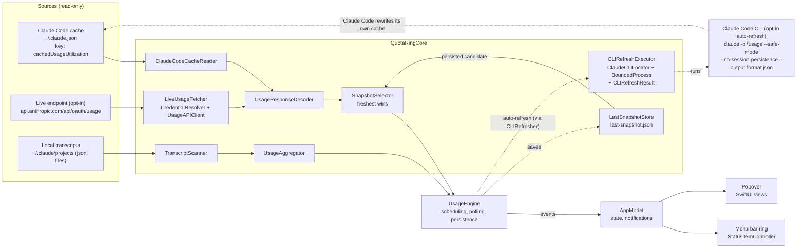

# Architecture

This is a map of how QuotaRing is put together, written for people who want to audit it or contribute. For the reasoning
behind the decisions, see the [design document](superpowers/specs/2026-10-20-quotaring-design.md). For what the app
reads, sends and stores, see [How it works and privacy](../README.md#how-it-works-and-privacy) and
[SECURITY.md](../SECURITY.md).

## Overview

QuotaRing is a menu bar app in two parts:

- **`QuotaRingCore`**: a Swift package (in `Core/`) with all the logic that does not need a UI: models, decoding, file
  and credential access, the API client, polling policy, transcript scanning, running Claude Code's `/usage`
  (auto-refresh) and formatting. It is tested with `swift test` and needs no Xcode project.
- **The app** (in `App/`): an AppKit status item, SwiftUI views, settings, onboarding and notifications. It owns state
  and scheduling and calls into Core.

There are no third-party runtime dependencies. Core uses Foundation, Security and CryptoKit; the app adds AppKit,
SwiftUI, Swift Charts, UserNotifications, ServiceManagement and Network.

## Repository layout

```
Core/
  Package.swift
  Sources/QuotaRingCore/
    Models/          usage models, the redacting Secret type, OAuth credential model
    Paths/           Claude config directory, cache file, projects directory, Keychain service names
    Decoding/        tolerant usage-response decoder, flexible date parsing
    Cache/           reader for Claude Code's cached usage snapshot
    Credentials/     credential parsing, Keychain and file sources, resolver
    Network/         HTTP transport, usage API client, Retry-After, polling policy, live fetcher
    Transcripts/     transcript line parser, incremental scanner, aggregator, model names
    Cli/             auto-refresh: finding and validating `claude`, the fixed command and environment, the bounded
                     process runner, result checking (the safety net), and the executor that ties them together
    Presentation/    formatting, snapshot logic (staleness, reset handling), refresh planning, whether anybody is
                     looking (UserPresence), threshold tracking
    Persistence/     LastSnapshotStore: the saved last good snapshot (last-snapshot.json)
    Resources/       English and Turkish strings for relative times and durations
  Tests/QuotaRingCoreTests/   Swift Testing tests and sanitized fixtures
App/
  QuotaRingApp.swift, AppDelegate.swift, AppModel.swift, UsageEngine.swift, SettingsStore.swift, DemoData.swift
  StatusItem/    status item controller, ring image renderer
  Popover/       popover view and its sections
  Settings/ Onboarding/ Services/    settings, first-run consent, notifications, launch at login, auto-refresh runner
  Resources/     Info.plist, entitlements, localized strings, asset catalog
AppTests/        Swift Testing tests of the app's logic (hostless bundle; Support/ holds the sandbox and fakes)
project.yml      XcodeGen spec (the .xcodeproj is generated and git-ignored)
Configs/         xcconfig files; Local.xcconfig is git-ignored
Makefile         setup, generate, build, run, demo, test, test-app, test-all, lint, format, clean
scripts/         icon generation, CI helpers (Xcode selection, pinned XcodeGen) and release scripts
.github/         CI, CodeQL, release workflow, templates
```

## Data flow



Two sources feed the limit percentage (plus the saved copy of the last good one); the third feeds the local detail.
`UsageEngine` decides when each source is read and hands the results to `AppModel` as events; `AppModel` only holds
state.

1. **Claude Code cache (default, token-free).** `ClaudeCodeCacheReader` reads `<config>/.claude.json`, extracts only
   `cachedUsageUtilization`, and returns a snapshot with `source = claudeCodeCache` and `fetchedAt` taken from the
   file's `fetchedAtMs`. It also compares the account id of the cached entry with `oauthAccount.accountUuid`. If they
   differ, the cache belongs to an account that is no longer signed in, and the app drops everything it holds for it:
   the cached numbers, the persisted snapshot (also deleted from disk) and any live numbers (`SnapshotCandidates`). The
   Live back-off is reset and the Live loop restarts, so the new account's usage is asked for at once; a Live request
   that started before the mismatch (its token may be the previous account's) is not sent, or its result is dropped. The
   reader never writes the file.
2. **Live endpoint (opt-in).** `LiveUsageFetcher` asks `CredentialResolver` for a token, then `UsageAPIClient` performs
   one request. Expired or missing credentials produce a "skipped" result with no network traffic.
3. **Local transcripts.** `TranscriptScanner` and `UsageAggregator` turn Claude Code's logs into token totals by model,
   project and day. This runs without any consent because no secret is involved, and it never feeds the limit
   percentage.

Both limit sources go through the same `UsageResponseDecoder`, so a live response and a cached copy of one are
interpreted identically.

Auto-refresh (opt-in, dashed above) is not a fourth source. It runs Claude Code's own `/usage`, which makes Claude Code
rewrite source 1, and then the cache is read at once instead of on the next 30-second check.

## Auto-refresh (opt-in)

For Claude desktop app users, whose cache Claude Code otherwise never refreshes. QuotaRing never reads a credential for
it: Claude Code uses and renews its own login.

```
UsageEngine (auto-refresh loop, MainActor)
  └─ RefreshPlanner.shouldRunCLIRefresh: on, data older than the refresh interval, ≥ 120 s since the last run,
     back-off over, awake, online and somebody can look at the numbers (see Polling)
      └─ CLIRefresher (App/Services): settings, user, LANG, private working folder ~/Library/Application Support/QuotaRing/cli
          └─ CLIRefreshExecutor (actor, Core/Cli)
              1. ClaudeCLILocator: chosen path, then the Claude desktop app's bundled builds
                 (~/Library/Application Support/Claude/claude-code/<version>/<build>/claude.app/Contents/MacOS/claude,
                 newest version first), then ~/.local/bin, ~/.claude/local, ~/.npm-global/bin, /opt/homebrew/bin,
                 /usr/local/bin; resolved through symlinks; regular, executable, owner = user or root, mode & 0o022 == 0
              2. for each usable file, in order (definitive answers cached per file identity, a check without an
                 answer rests that file for 30 min, 10 s limit each; the file is inspected again right before every
                 execution and must not have changed):
                 `--version` contains "(Claude Code)", and `--help` lists --safe-mode and --no-session-persistence;
                 not Claude Code or too old → try the next (none left: unsupportedVersion, else the first check
                 without an answer, else notFound)
              3. BoundedProcess: CLIRefreshCommand.arguments, minimal environment (auto-updater off; Claude Code asked not
                 to send telemetry or error reports),
                 stdin /dev/null, stderr discarded, 30 s limit, 256 KB output limit, SIGTERM then SIGKILL to the
                 process group
              4. CLIRefreshResult.parse → success | modelCallDetected | notLoggedIn | failed(reason)
  └─ RefreshPlanner.resolveCLIRun: on success read the cache now; an entry that did not get newer is cacheNotUpdated,
     a cache that cannot be read is cacheUnreadable; an abandoned run is dropped unless it detected a model call
  └─ cacheNotUpdated only (RefreshPlanner.cliRunNeedsLoginCheck): CLIRefreshExecutor.isLoggedIn asks the same, still
     unchanged tool `auth status --json`, only if its `--help` listed the `auth` command (without it, `auth` would be
     an interactive prompt); environment and folder of the run, 10 s limit, 16 KB output cap; exit 0 or 1 with a JSON
     object. CLIRefreshResult.loginState reads `loggedIn` and nothing else; RefreshPlanner.cliOutcome turns a
     signed-out answer into notLoggedIn (Claude Code 2.1.308 answers `/usage` signed out with exit 0 and no refresh)
  └─ RefreshPlanner.cliRetry (back-off as Live mode) and cliStatus → AppModel.cliStatus → Settings and popover
  └─ RefreshPlanner.cliSafety: modelCallDetected, or 3 exit-0 runs in a row with unverifiable output →
     SettingsStore.stopCLIRefreshForSafety(reason) (feature off, reason remembered until turned on again)
```

- **Consent.** `cliRefreshEnabled` and `customCLIPath` are read from the app's saved preferences only (like Live mode's
  consent), so launch arguments can neither turn auto-refresh on nor choose what it runs. Nothing runs before
  onboarding is complete. Settings never turns it on without the consent sheet; the popover only opens Settings.
- **Before consent** only file metadata is inspected (to show the path in Settings); the `--version` and `--help` checks
  are part of the first run.
- **Consent version.** `CLIRefreshCommand.consentVersion` is saved with the consent; version 2 added the login check.
  A consent for another version reads as off, and `SettingsStore.cliRefreshNeedsNewConsent` makes the popover and
  Settings → Data say why until the user turns auto-refresh on (agreeing again) or chooses Keep It Off.
- **Environment.** Exactly `HOME`, `USER`, `LOGNAME`, `LANG`, `PATH`, `DISABLE_AUTOUPDATER=1`, `DISABLE_TELEMETRY=1` and
  `DISABLE_ERROR_REPORTING=1` (plus `CLAUDE_CONFIG_DIR` for a custom config directory), for the checks, the run and the
  login check alike: nothing QuotaRing starts may update Claude Code, and Claude Code is asked not to send telemetry or error
  reports (`DISABLE_TELEMETRY`, `DISABLE_ERROR_REPORTING`; honoring that is up to Claude Code). `CLAUDE_CODE_DISABLE_NONESSENTIAL_TRAFFIC` is deliberately absent: it makes `/usage` answer from
  the stale cache without a network request.
- **Process handling.** `BoundedProcess` keeps every `Process`, `Pipe` and `FileHandle` inside one run. The launch and
  all watching happen on a Dispatch queue, never on Swift's cooperative pool and never under a lock a cancellation
  needs. Cancelling the waiting task (sleep, the feature turned off, settings changed, QuotaRing quitting) stops the
  process group. Helpers a finished tool leaves in its process group are stopped too, while the run is under way;
  the tool's own exit and output are kept, so a finished run is still judged (a detected model call still counts).
- **Safety net.** A success needs `type: result`, `is_error: false`, `num_turns: 0` and `total_cost_usd: 0`. Any turn,
  cost, or token or request count above zero means the model was used: the feature turns itself off.
- **Manual refresh.** Refresh runs it first (at most once a minute, ignoring back-off and data age); when it succeeds,
  the Live request of the same refresh is skipped.

## Source selection

- `SnapshotSelector.freshest` picks the candidate with the newest `fetchedAt` among the cached, live and persisted
  snapshots. On a tie, the live snapshot wins.
- Automatic Live polls only run when Live mode is enabled, the freshest snapshot is older than the refresh interval and
  the token has not expired, so QuotaRing does not call Anthropic when Claude Code has just refreshed its own cache.
  A manual refresh in Live mode is the one exception to the age check, limited by the 60 s cooldown.
- A failed or partial read never replaces good data. If the cache file is mid-write and cannot be parsed, the reader
  reports a malformed file and the app keeps the previous snapshot. It never shows 0% because of a bad read. The one
  deliberate exception is an account mismatch (above), which removes the numbers on purpose.
- The session is evaluated at the current time: if its `resetsAt` has passed, it is shown as reset (0% used, waiting for
  fresh data) instead of the old percentage. This covers a laptop that slept through a reset.
- The UI always shows the source and age ("Claude Code · 3 min ago", "Live · 1 min ago") and marks stale data. A
  snapshot is stale when it is older than two refresh intervals (10 minutes by default). Then the menu bar dims the
  percentage and draws a dashed arc on a dashed faint track (`RingImageRenderer`), and shows "–" with a dashed track
  alone when the stale session window has already reset; the popover adds a hint.
- A cached snapshot whose `fetchedAtMs` lies more than 5 minutes in the future is rejected as malformed (and a saved one
  is ignored on load): it would otherwise look fresh until then and hide every real update.
- A cache file that exists but cannot be used is reported by `CacheReadHealth`: a file over 50 MB or one that cannot be
  opened shows a warning in the popover at once, a malformed file only after 90 seconds without a good read (Claude
  Code rewrites the file often, so a single torn read is normal).
- Only the `claude` command-line tool updates the cache that the default mode reads; the Claude desktop app does not
  (verified 2026-10-21). Desktop-app users therefore see stale data in default mode unless they turn on auto-refresh
  (below), run `claude` or `/usage` themselves, or turn on Live mode (see the README,
  [Keeping the numbers fresh](../README.md#keeping-the-numbers-fresh)).

`LastSnapshotStore` saves the last good snapshot to `~/Library/Application Support/QuotaRing/last-snapshot.json` so the
ring is meaningful right after launch. The file holds the usage percentages and reset times, the weekly breakdown, the
extra-usage flag and percentage (money amounts are stripped), limit metadata, when it was fetched and from which source,
and the absolute path of the Claude config directory it was read from, and never a token. It is written atomically with mode 600 in a mode 700 folder, loaded only
for the same config directory, and ignored if it is not a regular file or larger than 1 MiB. A loaded snapshot is not
marked stale as such: it is stale by age, like any other snapshot. It is deleted when the config directory changes or
the cache turns out to belong to another account.

## Decoding

`UsageResponseDecoder` is deliberately tolerant, because the response format is undocumented and Claude Code adds fields
over time:

- Prefers the `limits[]` array (`session`, `weekly_all`, `weekly_scoped`; unknown kinds are kept and shown generically).
- Falls back to the legacy keys (`five_hour`, `seven_day`, `seven_day_opus`, and so on).
- `percent` and `utilization` are **percent used** (0 to 100) and are clamped. Remaining is `100 - used`.
- `resets_at` accepts ISO 8601 with any fractional digits and offset, or epoch seconds, or `null`.
- One malformed entry is dropped without discarding the rest. Unknown keys are ignored. If nothing usable remains, decoding
  throws and the app keeps its last good snapshot.
- Sizes are bounded, because the popover builds every row: at most 32 usable limits and 16 breakdown rows are kept, in
  response order, and breakdown rows are de-duplicated by `key` (the first wins). An `extra_usage.decimal_places`
  outside 0 to 6 and a `currency` that is not three uppercase letters are dropped, so the defaults apply; the popover
  clamps the places again before formatting money.
- Before decoding, `URLSessionTransport` refuses a Live response body over 1 MiB: a larger `Content-Length` before the
  body is read, a longer stream as soon as it passes the limit. The client reports it as a decoding failure.
- `ClaudeCodeCacheReader` opens `.claude.json` once (following symlinks, `O_NONBLOCK`), checks the open descriptor with
  `fstat` (regular file, at most 50 MB) and reads it with a bounded loop, so the file cannot be swapped between the
  check and the read, and a FIFO cannot block it.

## Polling

| Concern | Behavior |
| --- | --- |
| Cache | `stat` every 30 seconds; parse only when size or modification time changed; skip files over 50 MB |
| Live interval | 300 s by default; options 180, 300, 600, 900 s; +/-10% jitter |
| Back-off | Doubles per consecutive failure, capped at 1800 s; `Retry-After` (seconds or HTTP date) is honored but never shortens the base interval |
| Status codes | 200 decode; 401/403 "needs re-login" state; 429 rate-limited back-off; 5xx and network errors back off and keep stale data |
| Keychain access denied | Resolution stops at the refusal (no other Keychain item, no credentials file); automatic requests stop and a message is shown. QuotaRing does not ask again until the user presses Refresh, turns Live mode off and on, or relaunches QuotaRing. Meanwhile the Live loop sleeps for the longest wait (6 h, `RefreshPlanner.nextCheckDelay` with `isSuspended`) instead of checking every second, and is restarted when the suspension is lifted. A refusal counts also when it arrives after the request was cancelled (for example the screen locked while the prompt stayed open and the user clicked Deny on return); a credential granted after the cancellation sends nothing |
| Auto-refresh (opt-in) | Runs Claude Code's `/usage` when the freshest snapshot is older than the refresh interval (+/-10% jitter), at most every 120 s; back-off as Live mode after failures; paused while asleep, offline or away (see System state) |
| Manual refresh | Re-reads the cache immediately; with auto-refresh on, runs it once (at most once per 60 s); in Live mode also makes one request (never with an expired token, skipped when auto-refresh just succeeded), at most once per 60 s |
| System state | Pauses everything on system sleep, and the Live and auto-refresh loops also while offline or *away*: all displays asleep (`NSWorkspace` `screensDidSleep`/`screensDidWake`), the user's session in the background (`sessionDidResignActive`/`sessionDidBecomeActive`) or the screen locked (the distributed `com.apple.screenIsLocked`/`screenIsUnlocked`, which are undocumented; nothing depends on them alone). The decision is `UserPresence` in Core. The 30 s cache check goes on, it costs a `stat`. On wake, reconnect and return the loops start again with an immediate check of what is due, respecting cooldown and back-off. Opening the popover or pressing Refresh counts as being back, so a missed wake or unlock cannot leave them paused |
| Countdown | Ticks locally (every 30 s) between polls; no network needed. The menu bar button is touched only when what it shows changed (image, title or label), and not at all while all displays sleep; it is brought up to date once on wake |
| Transcripts | Scanned on popover open and every 60 s while it is open; a scan under way stops when the popover closes and carries on from there next time |

`PollingPolicy` is a pure function of the last outcome, the failure count, `Retry-After` and a random value, so it is
unit-tested without timers.

## Credentials (Live mode only)

`CredentialResolver` tries sources in order and uses the first with a non-empty `claudeAiOauth.accessToken`. The order
depends on the Claude config directory (`ClaudePaths.keychainServiceNames`):

| Config directory | Sources, in order |
| --- | --- |
| Default (`~/.claude`) | 1. Keychain `Claude Code-credentials`. 2. Keychain `Claude Code-credentials-<first 8 hex of sha256(config directory)>`. 3. `<config>/.credentials.json`. |
| Custom (chosen in Settings) | 1. Keychain `Claude Code-credentials-<first 8 hex of sha256(config directory)>` only. 2. `<config>/.credentials.json`. |

The plain `Claude Code-credentials` item belongs to the default account, so a custom directory never reads it.
`.credentials.json` is used only if it is a regular file owned by the current user and not group or world readable.

Rules enforced in code:

- Read through the Security framework, read-only. Re-read on every poll; never cached across polls.
- The token lives in a `Secret` whose `description`, `debugDescription` and reflection are redacted, and which is not
  `Codable`.
- An expired token (60 s skew) is not sent. The app falls back to the cache and shows a hint.
- No refresh logic exists. The only time `claude` is launched is the opt-in auto-refresh command (above), which reads
  no credential on QuotaRing's side.

Nothing is read until the user gives consent in onboarding or Settings. Consent is recorded as soon as the user clicks
"Enable Live mode"; in onboarding, only the first Keychain read is delayed until the notification prompt has settled
(at most 15 seconds), so two system prompts do not appear together. The consent settings are read from the app's saved
preferences only, so command-line launch arguments cannot turn Live mode on. If the user denies the Keychain prompt
(or the keychain is locked), resolution stops there, without trying another item or the credentials file, and Live mode
does not ask again until the user presses Refresh, turns Live mode off and on, or relaunches QuotaRing.

## Transcripts

`TranscriptScanner` is an actor that scans `projects/**/*.jsonl` incrementally:

- Lists the tree once per scan (`readdir`, one `fstatat` with `AT_SYMLINK_NOFOLLOW` per `.jsonl`) and opens a file
  only when needed: a file whose device, inode, size and modification time are what the last pass left is not opened
  at all, so a rescan of an unchanged tree opens nothing.
- Never follows a link below the projects directory, also not one that appears after the listing. The projects
  directory itself may be a link: it is resolved and opened once per scan, and that descriptor is the anchor of
  everything else. Subdirectories are opened with `openat` relative to their parent's descriptor, and each file is
  opened later by walking its path from the anchor one component at a time, with `openat` and `O_NOFOLLOW` at every
  step (never by a full path, which would let a directory swapped for a link after the listing be followed). Entries
  that are links, pipes, sockets or devices are not listed, and a component that has become a link fails to open and
  is skipped. Hard links are ordinary files and are read.
- Never opens a file last modified before `now − 8 days` and forgets its state: a log is append-only, so none of its
  lines can be newer than its modification time. Most of a long history is skipped this way.
- Keeps `(device, inode, size, mtime, byteOffset)` per file and parses only appended bytes; a shrunken, replaced or
  restored file (smaller size, other inode, older modification time) is re-read from the start.
- Reads a file's identity with `fstat` on the open descriptor, so it describes the bytes that are read; only regular
  files are read.
- Reads in 1 MiB chunks, each inside an `autoreleasepool`, so memory follows the chunk size, not the bytes read.
- Ignores an incomplete trailing line until it is completed. Skips lines over 10 MB.
- Stops at the next directory, file or chunk when its task is cancelled (the popover closing), keeps what it read, and
  opens that file again next time even if it did not change.
- Uses only assistant lines with `message.usage`, skips the `<synthetic>` model, and de-duplicates globally by message id
  (plus request id), keeping the per-field maximum because Claude Code writes repeated usage per content block.
- Keeps only timestamp, model, token counts, project name and the dedupe key. Message text is never retained, and
  entries older than 8 days are dropped from memory (a line that old is dropped as soon as it is parsed).
- Days are grouped in the user's local time zone, not UTC.

`UsageAggregator` is pure: it turns entries into totals by model family, project and day. Token figures are labelled
approximate in the UI.

## App layer

- **`AppModel`** (`@MainActor`, `@Observable`) holds the current snapshot, Live status, activity breakdowns and refresh
  state. Views and the status item render from it.
- **`UsageEngine`** runs the cache, Live and auto-refresh loops (all scheduling), sleep/wake, presence (displays,
  session, lock screen) and reachability handling, and persistence of the last snapshot. It reports to `AppModel`
  through events.
- **`CLIRefresher`** (`App/Services`) gives Core's `CLIRefreshExecutor` what only the app knows (user, `LANG`, the
  settings, the private working folder) and logs outcome names only.
- **`StatusItemController`** owns the `NSStatusItem`, draws the ring with `RingImageRenderer` (dimmed percentage and
  a dashed arc on a dashed faint track when the data is stale, "–" with a dashed track alone after a stale reset), hosts
  the SwiftUI popover in an `NSPopover`, and provides the right-click menu and VoiceOver label. The popover's SwiftUI
  content (an `NSHostingController`) exists only while the popover is open: it is created right before the popover is
  shown and dropped when it has closed, because a live hierarchy keeps its `TimelineView` refreshing and costs
  about 18 MiB while hidden. What must survive an opening (the Activity range) lives in `AppModel`. The button is
  updated through `StatusButtonState`, which compares what it shows (ring fraction and style, text and dimming,
  label) with the new presentation and touches only what differs.
- **`NotificationService`** fires each threshold once per window. The window is identified by `resetsAt` rounded to the
  minute, because the reported value jitters by sub-seconds between fetches.
- **`SettingsStore`** is UserDefaults-backed and holds non-sensitive values only. The consent settings (Live mode,
  auto-refresh, onboarding completed), the chosen `claude` path and the Claude config directory ignore command-line
  launch arguments. Each consent is saved with the version of its feature (`UsageAPI.consentVersion`,
  `CLIRefreshCommand.consentVersion`) and counts only for that version, so a release that raises it asks again;
  turning a feature off clears both.
- **Demo mode** (`--demo`) swaps in fixture data and never touches the Keychain, the network or Claude files.

## Concurrency and logging

Swift 6 language mode with `SWIFT_STRICT_CONCURRENCY = complete`. UI state is on the main actor; the transcript scanner
is an actor; Core types are `Sendable`. Logging uses `os.Logger` with privacy annotations and never includes tokens or
file contents.

## Testing

Core logic is tested with Swift Testing (`make test`): decoders against sanitized real-shaped fixtures, cache extraction
(including truncated, oversized and decoy-secret cases), credential parsing and resolver order, the API client against a
recording stub transport, polling policy bounds, the scanner's dedupe and incremental behavior (including that files
outside the retention window and unchanged files are not opened, and cancellation), the presence logic, redaction,
formatting and threshold logic, and auto-refresh: locating and validating the tool (with temporary files), the exact command and
environment, result parsing and the safety net, the process runner and executor (with fake `#!/bin/sh` tools that record
their arguments, environment and working folder, hang, exit with errors or print too much), and the scheduling rules.
Tests never touch the real Keychain, real Claude files or the network, and never run the real `claude`.

The app's own logic is tested with Swift Testing too (`make test-app`, in `AppTests/`): the settings store (including
that consent, the Claude config directory and the tool path are read only from what the app saved, never from launch
arguments), the welcome window's model (what each button and the close button record, the notification prompt and the
Live gate), the text and ring of the menu bar item and which parts of the button a new presentation changes, what the
popover's no-data section offers, `AppModel`'s derived state and notifications, `UsageEngine`'s cache, snapshot-saving,
transcript and presence handling, the ring renderer, the demo data and the notification texts. The test bundle is **hostless**: the app is never started, because that would read the
user's real Claude files and preferences. The app's sources are compiled into the bundle (all but `QuotaRingApp.swift`,
which has `@main`), and every test works in its own temporary folder and its own preferences file. `UsageEngine` takes
the credential read, the HTTP transport and the auto-refresh runner as parameters (the defaults are the real ones), so
its Live and auto-refresh loops are tested against fakes that count their calls: pausing while away, a Keychain refusal
that arrives after a cancellation, the restart after Refresh lifts a suspension. Nothing in a test reads the Keychain,
reaches the network or starts Claude Code. Not covered, because they have no seam without the real thing: the real
Keychain read, the real HTTP request and the real run of Claude Code (`CLIRefresher` itself), the system notifications
that report sleep, displays, session and lock screen, and the part of `NotificationService` that talks to
`UNUserNotificationCenter`.

CI (`.github/workflows/ci.yml`) runs Core's tests and `make lint`, builds unsigned and runs the app's tests on the newest
Xcode on the runner, and runs Core's tests, the unsigned build and the app's tests again on Xcode 16.4 exactly, the
minimum version the README promises. XcodeGen is installed from a pinned release whose SHA-256 is checked
(`scripts/ci/install-xcodegen.sh`).

## Where to look when auditing

| Question | Look at |
| --- | --- |
| What is read from `~/.claude.json`? | `Core/Sources/QuotaRingCore/Cache/` |
| Where is the token read, and how is it protected? | `Core/Sources/QuotaRingCore/Credentials/`, `Models/Secret.swift` |
| What is sent, and to where? | `Core/Sources/QuotaRingCore/Network/` (the endpoint constant is in the API client) |
| What program can it run, and how? | `Core/Sources/QuotaRingCore/Cli/`, `App/Services/CLIRefresher.swift` |
| What do transcripts contribute? | `Core/Sources/QuotaRingCore/Transcripts/` |
| What is stored on disk? | `Core/Sources/QuotaRingCore/Persistence/LastSnapshotStore.swift`, `App/UsageEngine.swift`, `App/SettingsStore.swift` |
| What can the app do at runtime? | `App/Resources/QuotaRing.entitlements`, `App/Resources/Info.plist` |
| How are releases built and signed? | `.github/workflows/release.yml` and `scripts/release/` |
