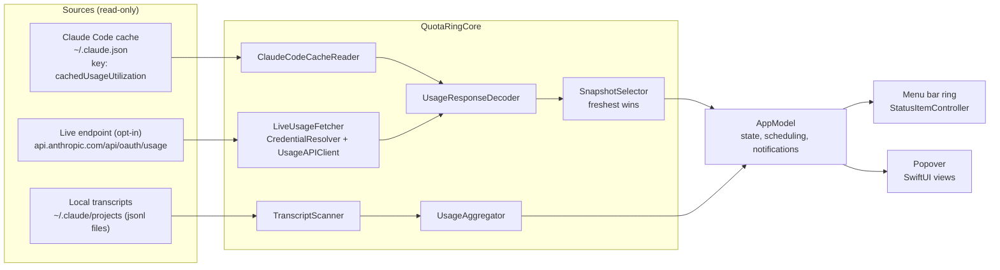

# Architecture

This is a map of how QuotaRing is put together, written for people who want to audit it or contribute. For the reasoning
behind the decisions, see the [design document](superpowers/specs/2026-10-20-quotaring-design.md). For what the app
reads, sends and stores, see [How it works and privacy](../README.md#how-it-works-and-privacy) and
[SECURITY.md](../SECURITY.md).

## Overview

QuotaRing is a menu bar app in two parts:

- **`QuotaRingCore`**: a Swift package (in `Core/`) with all the logic that does not need a UI: models, decoding, file
  and credential access, the API client, polling policy, transcript scanning and formatting. It is tested with
  `swift test` and needs no Xcode project.
- **The app** (in `App/`): an AppKit status item, SwiftUI views, settings, onboarding and notifications. It owns state
  and scheduling and calls into Core.

There are no third-party runtime dependencies. Core uses Foundation, Security and CryptoKit; the app adds AppKit,
SwiftUI, Swift Charts, UserNotifications, ServiceManagement and Network.

## Repository layout

```
Core/
  Package.swift
  Sources/QuotaRingCore/
    Models/          usage models, the redacting Secret type, OAuth credential model
    Paths/           Claude config directory, cache file, projects directory, Keychain service names
    Decoding/        tolerant usage-response decoder, flexible date parsing
    Cache/           reader for Claude Code's cached usage snapshot
    Credentials/     credential parsing, Keychain and file sources, resolver
    Network/         HTTP transport, usage API client, Retry-After, polling policy, live fetcher
    Transcripts/     transcript line parser, incremental scanner, aggregator, model names
    Presentation/    formatting, snapshot logic (staleness, reset handling), threshold tracking
  Tests/QuotaRingCoreTests/   Swift Testing tests and sanitized fixtures
App/
  QuotaRingApp.swift, AppDelegate.swift, AppModel.swift, UsageEngine.swift, SettingsStore.swift, DemoData.swift
  StatusItem/    status item controller, ring image renderer
  Popover/       popover view and its sections
  Settings/ Onboarding/ Services/    settings, first-run consent, notifications, launch at login
  Resources/     Info.plist, entitlements, localized strings, asset catalog
project.yml      XcodeGen spec (the .xcodeproj is generated and git-ignored)
Configs/         xcconfig files; Local.xcconfig is git-ignored
Makefile         setup, generate, build, run, demo, test, lint, format, clean
scripts/         icon generation and release scripts
.github/         CI, CodeQL, release workflow, templates
```

## Data flow



Two sources feed the limit percentage; the third feeds the local detail.

1. **Claude Code cache (default, token-free).** `ClaudeCodeCacheReader` reads `<config>/.claude.json`, extracts only
   `cachedUsageUtilization`, and returns a snapshot with `source = claudeCodeCache` and `fetchedAt` taken from the
   file's `fetchedAtMs`. If the file names an account that does not match the cached entry, the entry is ignored. The
   reader never writes the file.
2. **Live endpoint (opt-in).** `LiveUsageFetcher` asks `CredentialResolver` for a token, then `UsageAPIClient` performs
   one request. Expired or missing credentials produce a "skipped" result with no network traffic.
3. **Local transcripts.** `TranscriptScanner` and `UsageAggregator` turn Claude Code's logs into token totals by model,
   project and day. This runs without any consent because no secret is involved, and it never feeds the limit
   percentage.

Both limit sources go through the same `UsageResponseDecoder`, so a live response and a cached copy of one are
interpreted identically.

## Source selection

- `SnapshotSelector.freshest` picks the candidate with the newest `fetchedAt`. On a tie, the live snapshot wins.
- The Live loop only runs when Live mode is enabled and the freshest snapshot is older than the refresh interval, so
  QuotaRing does not call Anthropic when Claude Code has just refreshed its own cache.
- A failed or partial read never replaces good data. If the cache file is mid-write and cannot be parsed, the reader
  reports a malformed file and the app keeps the previous snapshot. It never shows 0% because of a bad read.
- The session is evaluated at the current time: if its `resetsAt` has passed, it is shown as reset (0% used, waiting for
  fresh data) instead of the old percentage. This covers a laptop that slept through a reset.
- The UI always shows the source and age ("Claude Code · 3 min ago", "Live · 1 min ago") and marks stale data.

The last good snapshot (percentages and reset times only) is saved to `~/Library/Application Support/QuotaRing/` so the
ring is meaningful right after launch, and is marked stale until fresh data arrives.

## Decoding

`UsageResponseDecoder` is deliberately tolerant, because the response format is undocumented and Claude Code adds fields
over time:

- Prefers the `limits[]` array (`session`, `weekly_all`, `weekly_scoped`; unknown kinds are kept and shown generically).
- Falls back to the legacy keys (`five_hour`, `seven_day`, `seven_day_opus`, and so on).
- `percent` and `utilization` are **percent used** (0 to 100) and are clamped. Remaining is `100 - used`.
- `resets_at` accepts ISO 8601 with any fractional digits and offset, or epoch seconds, or `null`.
- One malformed entry is dropped without discarding the rest. Unknown keys are ignored. If nothing usable remains, decoding
  throws and the app keeps its last good snapshot.

## Polling

| Concern | Behavior |
| --- | --- |
| Cache | `stat` every 30 seconds; parse only when size or modification time changed; skip files over 50 MB |
| Live interval | 300 s by default; options 180, 300, 600, 900 s; +/-10% jitter |
| Back-off | Doubles per consecutive failure, capped at 1800 s; `Retry-After` (seconds or HTTP date) is honored but never shortens the base interval |
| Status codes | 200 decode; 401/403 "needs re-login" state; 429 rate-limited back-off; 5xx and network errors back off and keep stale data |
| Manual refresh | Re-reads the cache immediately; also calls the endpoint in Live mode, with a 60 s cooldown |
| System state | Pauses on sleep and while offline; refreshes on wake and reconnect, respecting cooldown and back-off |
| Countdown | Ticks locally (every 30 s) between polls; no network needed |
| Transcripts | Scanned on popover open and every 60 s while it is open |

`PollingPolicy` is a pure function of the last outcome, the failure count, `Retry-After` and a random value, so it is
unit-tested without timers.

## Credentials (Live mode only)

`CredentialResolver` tries sources in order and uses the first with a non-empty `claudeAiOauth.accessToken`:

1. Keychain generic password, service `Claude Code-credentials`.
2. Keychain generic password, service `Claude Code-credentials-<first 8 hex of sha256(config directory)>`.
3. `<config>/.credentials.json`, only if it is a regular file owned by the current user and not group or world readable.

Rules enforced in code:

- Read through the Security framework, read-only. Re-read on every poll; never cached across polls.
- The token lives in a `Secret` whose `description`, `debugDescription` and reflection are redacted, and which is not
  `Codable`.
- An expired token (60 s skew) is not sent. The app falls back to the cache and shows a hint.
- No refresh logic exists, and the `claude` CLI is never launched.

Nothing is read until the user gives consent in onboarding or Settings.

## Transcripts

`TranscriptScanner` is an actor that scans `projects/**/*.jsonl` incrementally:

- Keeps `(path, size, mtime, byteOffset)` per file and parses only appended bytes; a shrunken file is re-read.
- Ignores an incomplete trailing line until it is completed. Skips lines over 10 MB.
- Uses only assistant lines with `message.usage`, skips the `<synthetic>` model, and de-duplicates globally by message id
  (plus request id), keeping the per-field maximum because Claude Code writes repeated usage per content block.
- Keeps only timestamp, model, token counts, project name and the dedupe key. Message text is never retained.
- Days are grouped in the user's local time zone, not UTC.

`UsageAggregator` is pure: it turns entries into totals by model family, project and day. Token figures are labelled
approximate in the UI.

## App layer

- **`AppModel`** (`@MainActor`, `@Observable`) holds the current snapshot, Live status, activity breakdowns and refresh
  state. Views and the status item render from it.
- **`UsageEngine`** runs the cache and Live loops, sleep/wake and reachability handling, and persistence of the last
  snapshot.
- **`StatusItemController`** owns the `NSStatusItem`, draws the ring with `RingImageRenderer`, hosts the SwiftUI popover
  in an `NSPopover`, and provides the right-click menu and VoiceOver label.
- **`NotificationService`** fires each threshold once per window. The window is identified by `resetsAt` rounded to the
  minute, because the reported value jitters by sub-seconds between fetches.
- **`SettingsStore`** is UserDefaults-backed and holds non-sensitive values only.
- **Demo mode** (`--demo`) swaps in fixture data and never touches the Keychain, the network or Claude files.

## Concurrency and logging

Swift 6 language mode with `SWIFT_STRICT_CONCURRENCY = complete`. UI state is on the main actor; the transcript scanner
is an actor; Core types are `Sendable`. Logging uses `os.Logger` with privacy annotations and never includes tokens or
file contents.

## Testing

Core logic is tested with Swift Testing (`make test`): decoders against sanitized real-shaped fixtures, cache extraction
(including truncated, oversized and decoy-secret cases), credential parsing and resolver order, the API client against a
recording stub transport, polling policy bounds, the scanner's dedupe and incremental behavior, redaction, formatting and
threshold logic. Tests never touch the real Keychain, real Claude files or the network.

## Where to look when auditing

| Question | Look at |
| --- | --- |
| What is read from `~/.claude.json`? | `Core/Sources/QuotaRingCore/Cache/` |
| Where is the token read, and how is it protected? | `Core/Sources/QuotaRingCore/Credentials/`, `Models/Secret.swift` |
| What is sent, and to where? | `Core/Sources/QuotaRingCore/Network/` (the endpoint constant is in the API client) |
| What do transcripts contribute? | `Core/Sources/QuotaRingCore/Transcripts/` |
| What is stored on disk? | `App/UsageEngine.swift`, `App/SettingsStore.swift` |
| What can the app do at runtime? | `App/Resources/QuotaRing.entitlements`, `App/Resources/Info.plist` |
| How are releases built and signed? | `.github/workflows/release.yml` and `scripts/release/` |
